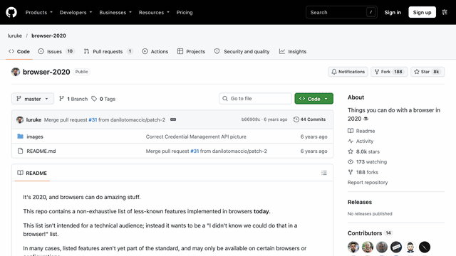

It's almost 2027, and browsers can do amazing stuff. Again.

Seven years ago I created [browser-2020](https://github.com/luruke/browser-2020) and listed things you could do with a browser in 2020. This is the sequel.

Same rules: a non-exhaustive list of less-known features implemented in browsers today. It isn't intended for a technical audience; it wants to be an "I didn't know we could do that in a browser!" list.

- [Graphics and 3D](#graphics-and-3d)
- [Motion and layout](#motion-and-layout)
- [AI in the browser](#ai-in-the-browser)
- [Hardware and devices](#hardware-and-devices)
- [Windows, capture and system](#windows-capture-and-system)
- [Apps, identity and navigation](#apps-identity-and-navigation)
- [Landing soon](#landing-soon-beta-origin-trial-flags)

---

# Graphics and 3D

## [WebGPU](https://developer.mozilla.org/en-US/docs/Web/API/WebGPU_API)
The successor to WebGL: modern GPU rendering and general-purpose GPU compute. It is now in every engine, including iPhone and Vision Pro.

|  Chrome |  Safari |  Firefox |
|:-:|:-:|:-:|
| ✅ 113 | ✅ 26 | 🟡 141 |

_Chrome on Android from 121, partially on Linux from 144. Firefox on Windows from 141 and Apple-silicon Macs from 147; not yet on Linux, Android or Intel Macs._

---

## [HTML-in-Canvas](https://developer.chrome.com/blog/html-in-canvas)
Draw real, live HTML into a 2D canvas, a WebGL texture or a WebGPU texture. The text stays selectable, forms stay usable and screen readers still see it. You can finally put a shader on a `
`.

|  Chrome |  Safari |  Firefox |
|:-:|:-:|:-:|
| ✅ 157 | 🧪 flag | ❌ |

_WebKit has started implementing it behind a flag; no signal from Firefox._

---

## [`<model>` element](https://webkit.org/blog/18325/webkit-features-for-safari-27-0/)
Drop an interactive 3D model into a page the way you drop an ``. No JavaScript, no WebGL.

|  Chrome |  Safari |  Firefox |
|:-:|:-:|:-:|
| ❌ | ✅ 27 | ❌ |

_On iPhone, iPad, Mac and Vision Pro._

---

## [HDR on the web](https://developer.mozilla.org/en-US/docs/Web/CSS/dynamic-range-limit)
Photos, video and WebGPU canvases can be brighter than "white" on HDR screens, and CSS can cap how bright each element is allowed to get.

|  Chrome |  Safari |  Firefox |
|:-:|:-:|:-:|
| ✅ 136 | 🟡 26 | 🟡 video, Windows |

---

## [JPEG XL](https://developer.chrome.com/blog/jpeg-xl-in-chrome)
The image format Chrome removed in 2023 is back. Smaller files, HDR, progressive loading.

|  Chrome |  Safari |  Firefox |
|:-:|:-:|:-:|
| ✅ 155 | ✅ 17 | ✅ 158 |

---

## [WebXR](https://developer.mozilla.org/en-US/docs/Web/API/WebXR_Device_API)
VR and AR from a URL, now with hand tracking, depth sensing and plane detection (walls, floors, tables).

|  Chrome |  Safari |  Firefox |
|:-:|:-:|:-:|
| 🟡 Android | 🟡 Vision Pro, VR only | ❌ |

_Chrome on Android and Android XR headsets, plus Meta Quest Browser. Still nothing on iPhone._

---

## [Immersive website environments](https://webkit.org/blog/17967/news-from-wwdc26-webkit-in-safari-27-beta/)
On a Vision Pro a website can replace the room around you with its own 3D environment. Spatial photos, 180° and 360° video play natively too.

|  Chrome |  Safari |  Firefox |
|:-:|:-:|:-:|
| ❌ | 🟡 visionOS 27 | ❌ |

---

## [WebAssembly 3.0](https://webassembly.org/features/)
Run code written in C++, Rust, Kotlin, Dart or C# at near-native speed. It now has garbage collection, more than 4 GB of memory and a way to call async web APIs from synchronous code.

|  Chrome |  Safari |  Firefox |
|:-:|:-:|:-:|
| ✅ | 🟡 | ✅ |

_GC and JSPI are in every engine. Memory64 is in Chrome 133 and Firefox 134, and in the Safari 27.3 beta._

---

## [WebCodecs](https://developer.mozilla.org/en-US/docs/Web/API/WebCodecs_API)
Direct access to the browser's video and audio encoders and decoders, frame by frame. This is what in-browser video editors are built on.

|  Chrome |  Safari |  Firefox |
|:-:|:-:|:-:|
| ✅ 94 | ✅ 26 | 🟡 130, desktop |

_Safari has had video since 16.4._

---

## [WebTransport](https://developer.mozilla.org/en-US/docs/Web/API/WebTransport_API)
Low-latency two-way streams between browser and server over HTTP/3. Think WebSockets for games and live media.

|  Chrome |  Safari |  Firefox |
|:-:|:-:|:-:|
| ✅ | ✅ 26.4 | ✅ |

---

# Motion and layout

## [View Transitions](https://developer.mozilla.org/en-US/docs/Web/API/View_Transition_API)
Animated morphs between two states of a page, or between two entirely separate pages, without a framework.

|  Chrome |  Safari |  Firefox |
|:-:|:-:|:-:|
| ✅ | ✅ | 🟡 same-page |

_Same-page: every engine since October 2025. Cross-page: Chrome 126 and Safari 18.2. Several at once on different elements: Chrome 147._

---

## [Scroll-driven animations](https://developer.mozilla.org/en-US/docs/Web/CSS/CSS_scroll-driven_animations)
Tie an animation to the scroll position in pure CSS. It runs off the main thread, so it stays smooth when JavaScript is busy.

|  Chrome |  Safari |  Firefox |
|:-:|:-:|:-:|
| ✅ | ✅ | ✅ 159 |

---

## [Scroll-triggered animations](https://developer.chrome.com/blog/scroll-triggered-animations)
Play, pause or reset a normal time-based animation when an element scrolls into view. No JavaScript, no IntersectionObserver.

|  Chrome |  Safari |  Firefox |
|:-:|:-:|:-:|
| ✅ 146 | ❌ | ❌ |

---

## [Anchor positioning](https://developer.mozilla.org/en-US/docs/Web/CSS/CSS_anchor_positioning)
Tether a tooltip or menu to any other element in CSS, and let it flip automatically when it would leave the screen.

|  Chrome |  Safari |  Firefox |
|:-:|:-:|:-:|
| ✅ 125 | ✅ 26 | ✅ 147 |

---

## [Customizable `<select>`](https://developer.chrome.com/blog/a-customizable-select)
After roughly 30 years you can fully style a native dropdown, including images inside options.

|  Chrome |  Safari |  Firefox |
|:-:|:-:|:-:|
| ✅ 135 | ✅ 27 | 🧪 flag |

---

## [CSS carousels](https://developer.chrome.com/blog/carousels-with-css)
Carousels with arrows and dots made by the browser, in CSS only.

|  Chrome |  Safari |  Firefox |
|:-:|:-:|:-:|
| ✅ 135 | ❌ | ❌ |

---

## [Popovers and invoker commands](https://developer.chrome.com/blog/command-and-commandfor)
Buttons that open dialogs, menus and hover cards with HTML attributes instead of JavaScript.

|  Chrome |  Safari |  Firefox |
|:-:|:-:|:-:|
| ✅ | ✅ | ✅ |

_Hover cards (`interestfor`) are Chrome 142 only._

---

## [Squircles and shaped borders](https://developer.mozilla.org/en-US/docs/Web/CSS/corner-shape)
Corners can be squircles, scoops, notches or bevels, and a border can follow any shape.

|  Chrome |  Safari |  Firefox |
|:-:|:-:|:-:|
| ✅ 139 | 🧪 27.3 beta | ❌ |

_`border-shape` is Chrome 147 only._

---

## [CSS that computes](https://developer.chrome.com/blog/if-article)
CSS now has `if()` conditionals, custom functions with `@function`, `random()`, and `sibling-index()` for staggered effects.

|  Chrome |  Safari |  Firefox |
|:-:|:-:|:-:|
| ✅ | 🟡 | 🟡 |

_`if()` Chrome 137 and `@function` Chrome 139, both in the Safari 27.3 beta. `random()`: Safari 26.2, Chrome 156, Firefox 161 beta. `sibling-index()`: every engine._

---

## [Animate to `height: auto`](https://developer.mozilla.org/en-US/docs/Web/CSS/interpolate-size)
One line of CSS (`interpolate-size: allow-keywords`) fixes the oldest animation problem on the web.

|  Chrome |  Safari |  Firefox |
|:-:|:-:|:-:|
| ✅ | 🧪 Tech Preview | ❌ |

---

## [Grid Lanes (masonry)](https://gridlanes.webkit.org)
Pinterest-style masonry layout as a built-in CSS layout mode.

|  Chrome |  Safari |  Firefox |
|:-:|:-:|:-:|
| 🧪 flag | ✅ 26.4 | 🧪 Nightly |

---

# AI in the browser

## [Prompt API](https://developer.chrome.com/docs/ai/prompt-api)
A language model ships inside the browser. Pages can prompt it with text, images and audio, offline, with nothing sent to a server.

|  Chrome |  Safari |  Firefox |
|:-:|:-:|:-:|
| 🟡 148, desktop | ❌ | ❌ |

_Needs about 22 GB of free disk. Mozilla and WebKit both formally oppose the API._

---

## [Translator, Summarizer and Language Detector](https://developer.chrome.com/docs/ai/built-in-apis)
On-device translation, summaries and language detection as plain JavaScript APIs.

|  Chrome |  Safari |  Firefox |
|:-:|:-:|:-:|
| 🟡 138, desktop | ❌ | ❌ |

---

## [On-device speech recognition](https://developer.mozilla.org/en-US/docs/Web/API/Web_Speech_API)
Speech-to-text that never leaves the machine.

|  Chrome |  Safari |  Firefox |
|:-:|:-:|:-:|
| 🟡 139, desktop | ❌ | 🟡 160, desktop |

---

## [Browsers that browse](https://webkit.org/blog/18136/introducing-the-safari-mcp-server-for-web-developers/)
The browser can be driven by an AI agent. Gemini in Chrome can click through tasks for you, and Safari ships an MCP server so coding agents can open and inspect pages.

_Gemini auto browse: Chrome, paid tiers, US first. Safari MCP server: Safari 27 on macOS._

---

# Hardware and devices

## [Web Serial](https://developer.chrome.com/docs/capabilities/serial)
Talk to Arduinos, 3D printers and other serial hardware. No longer Chrome-only, and no longer desktop-only.

|  Chrome |  Safari |  Firefox |
|:-:|:-:|:-:|
| ✅ | ❌ | 🟡 151, desktop |

_Chrome on Android from 148._

---

## [WebHID](https://developer.mozilla.org/en-US/docs/Web/API/WebHID_API), [WebUSB](https://developer.mozilla.org/en-US/docs/Web/API/WebUSB_API), [Web Bluetooth](https://developer.mozilla.org/en-US/docs/Web/API/Web_Bluetooth_API), [Web MIDI](https://developer.mozilla.org/en-US/docs/Web/API/Web_MIDI_API)
Stream Decks, game controllers, synths, heart-rate straps, LED strips.

|  Chrome |  Safari |  Firefox |
|:-:|:-:|:-:|
| ✅ | ❌ | 🟡 MIDI only |

_WebHID on Android from Chrome 158. Safari opposes all of them._

---

## [Gamepad rumble](https://developer.mozilla.org/en-US/docs/Web/API/GamepadHapticActuator)
Vibrate the controller, including the triggers on some pads.

|  Chrome |  Safari |  Firefox |
|:-:|:-:|:-:|
| ✅ | ✅ 16.4 | ✅ |

---

## [Foldable screens](https://developer.mozilla.org/en-US/docs/Web/API/Device_Posture_API)
Detect whether the device is folded and where the hinge splits the viewport.

|  Chrome |  Safari |  Firefox |
|:-:|:-:|:-:|
| ✅ 132 | 🧪 flag | ❌ |

_Chrome 132/138. Behind a flag on the foldable iPhone (Safari 27.1)._

---

## [Screen Wake Lock](https://developer.mozilla.org/en-US/docs/Web/API/Screen_Wake_Lock_API)
Stop the screen from dimming or sleeping.

|  Chrome |  Safari |  Firefox |
|:-:|:-:|:-:|
| ✅ | ✅ | ✅ |

---

## [Keyboard Lock](https://developer.mozilla.org/en-US/docs/Web/API/Keyboard_API)
In fullscreen, capture keys the system normally keeps, like Esc or Cmd-Tab.

|  Chrome |  Safari |  Firefox |
|:-:|:-:|:-:|
| ✅ | ✅ 26.4 | ❌ |

---

## [Compute Pressure](https://developer.mozilla.org/en-US/docs/Web/API/Compute_Pressure_API)
Find out whether the CPU is under strain, so you can lower quality before the fans start.

|  Chrome |  Safari |  Firefox |
|:-:|:-:|:-:|
| 🟡 125, desktop | ❌ | ❌ |

_Chrome 152 adds a CPU performance tier._

---

## [Permission elements](https://developer.chrome.com/blog/geolocation-html-element)
`<geolocation>`, `<camera>` and `<microphone>` are browser-drawn buttons that ask for access when clicked. No more permission popups out of nowhere.

|  Chrome |  Safari |  Firefox |
|:-:|:-:|:-:|
| ✅ 144 | ❌ | ❌ |

_Shipped across Chrome 144 to 153._

---

# Windows, capture and system

## [Document Picture-in-Picture](https://developer.mozilla.org/en-US/docs/Web/API/Document_Picture-in-Picture_API)
An always-on-top floating window that contains any HTML, not just a video.

|  Chrome |  Safari |  Firefox |
|:-:|:-:|:-:|
| 🟡 116, desktop | ❌ | 🟡 151, desktop |

---

## [Element Capture](https://developer.chrome.com/docs/web-platform/element-capture)
Record or stream a single element of the page instead of the whole tab. Chrome can also capture the Mac's system audio.

|  Chrome |  Safari |  Firefox |
|:-:|:-:|:-:|
| 🟡 132, desktop | ❌ | ❌ |

_System audio: Chrome 141 on macOS 14.2+._

---

## [Window Management](https://developer.mozilla.org/en-US/docs/Web/API/Window_Management_API)
List every connected display and open a window on a specific one. Useful for installations and multi-screen setups.

|  Chrome |  Safari |  Firefox |
|:-:|:-:|:-:|
| 🟡 desktop | ❌ | ❌ |

---

## [EyeDropper](https://developer.mozilla.org/en-US/docs/Web/API/EyeDropper_API)
Pick a colour from anywhere on screen, including outside the browser.

|  Chrome |  Safari |  Firefox |
|:-:|:-:|:-:|
| 🟡 desktop | ❌ | ❌ |

---

## [Local Font Access](https://developer.mozilla.org/en-US/docs/Web/API/Local_Font_Access_API)
List and use the fonts installed on the computer.

|  Chrome |  Safari |  Firefox |
|:-:|:-:|:-:|
| 🟡 desktop | ❌ | ❌ |

---

## [File System Access](https://developer.mozilla.org/en-US/docs/Web/API/File_System_API)
Open a file or folder, edit it and save it back in place. Every browser also offers a private, fast, per-site file system (OPFS).

|  Chrome |  Safari |  Firefox |
|:-:|:-:|:-:|
| ✅ | 🟡 OPFS only | 🟡 OPFS only |

---

# Apps, identity and navigation

## [Every site can be an app](https://webkit.org/blog/17333/webkit-features-in-safari-26-0/)
On iPhone, any site added to the Home Screen opens as its own app, with no manifest required. In Chrome a site can offer to install a different site's app.

_iOS 26. Web Install API: Chrome 158 desktop._

---

## [Declarative Web Push](https://webkit.org/blog/16535/meet-declarative-web-push/)
Push notifications that work without a service worker.

|  Chrome |  Safari |  Firefox |
|:-:|:-:|:-:|
| ❌ | ✅ 18.4 | ❌ |

_Safari 18.4 on iOS, 18.5 on macOS._

---

## [Digital Credentials](https://developer.chrome.com/blog/digital-credentials-api-shipped)
A site can ask for the driver's licence or ID stored in your phone's wallet.

|  Chrome |  Safari |  Firefox |
|:-:|:-:|:-:|
| ✅ 141 | ✅ 26 | ❌ |

---

## [Passkeys](https://developer.mozilla.org/en-US/docs/Web/API/Web_Authentication_API)
Sign in with Face ID or a fingerprint instead of a password, synced across your devices.

|  Chrome |  Safari |  Firefox |
|:-:|:-:|:-:|
| ✅ | ✅ | ✅ |

---

## [Speculation Rules](https://developer.mozilla.org/en-US/docs/Web/API/Speculation_Rules_API)
The browser can fully render the next page in the background, so clicking a link is instant.

|  Chrome |  Safari |  Firefox |
|:-:|:-:|:-:|
| ✅ | ❌ | ❌ |

---

## [Text fragments](https://developer.mozilla.org/en-US/docs/Web/URI/Reference/Fragment/Text_fragments)
Link to a specific sentence on any page. The browser scrolls to it and highlights it.

|  Chrome |  Safari |  Firefox |
|:-:|:-:|:-:|
| ✅ | ✅ | ✅ |

---

## [Temporal](https://developer.mozilla.org/en-US/docs/Web/JavaScript/Reference/Global_Objects/Temporal)
Dates and time zones in JavaScript that finally work.

|  Chrome |  Safari |  Firefox |
|:-:|:-:|:-:|
| ✅ 144 | 🧪 27.3 beta | ✅ 139 |

---

## [Web Coffee API](https://www.youtube.com/watch?v=dQw4w9WgXcQ)
Still not shipped. Seven years on, the covfefe protocol has no second implementer and WebKit's position is "oppose".

|  Chrome |  Safari |  Firefox |
|:-:|:-:|:-:|
| ❌ | ❌ | ❌ |

---

# Landing soon (beta, origin trial, flags)

## [Safari 27.3](https://developer.apple.com/documentation/safari-release-notes/safari-27_3-release-notes)
A very large release: CSS `if()`, `@function`, `corner-shape`, Temporal, WebAssembly Memory64 and WebGPU subgroups.

_Beta since 16 November 2026._

---

## [Adaptive Dark Mode](https://webkit.org/blog/18541/introducing-adaptive-dark-mode/)
Safari darkens sites that only have a light theme. Canvases are left untouched and pages can't detect it, so check your WebGL site against a darkened page around it.

_Safari 27.3 beta._

---

## [Spatial CSS](https://webkit.org/blog/18621/introducing-spatial-css-a-developer-preview/)
CSS for real 3D space: portals in the page, models positioned in real-world units, and scenes you can pull out of the window.

|  Chrome |  Safari |  Firefox |
|:-:|:-:|:-:|
| ❌ | 🧪 visionOS 27.3 | ❌ |

_Developer preview behind a flag._

---

## [WebMCP](https://developer.chrome.com/docs/ai/webmcp)
A page can expose its own "tools" to the browser's AI agent, so the agent calls a function instead of guessing where to click.

|  Chrome |  Safari |  Firefox |
|:-:|:-:|:-:|
| 🧪 origin trial | ❌ | ❌ |

_Origin trial runs from Chrome 149 to 162. WebKit opposes, Mozilla is neutral._

---

## [Web Haptics](https://github.com/WICG/web-haptics)
A proper haptics API (`navigator.playHaptics()` plus a CSS property), meant to work beyond Android.

|  Chrome |  Safari |  Firefox |
|:-:|:-:|:-:|
| 🧪 flag | ❌ | ❌ |

_Behind a flag from Chrome 156. No other engine has committed._

---

## [HDR for 2D canvas and richer canvas text](https://chromestatus.com/feature/5077164932333568)
HDR tone mapping for the 2D canvas, and text metrics detailed enough to animate and select individual glyph clusters.

|  Chrome |  Safari |  Firefox |
|:-:|:-:|:-:|
| 🧪 160 | ❌ | ❌ |

_Planned for Chrome 160 (January 2027)._

---

## [WebGPU bindless](https://toji.dev/2026/10/06/webgpu-bindless.html)
Thousands of textures available to one shader, which large scenes need. Ray-tracing proposals were opened in the working group in October 2026.

|  Chrome |  Safari |  Firefox |
|:-:|:-:|:-:|
| 🧪 flag | ❌ | ❌ |

_Ray tracing is a proposal only._

---

## [WebNN](https://webmachinelearning.github.io/webnn-status/)
Run machine-learning models on the device's neural processor rather than only the GPU.

|  Chrome |  Safari |  Firefox |
|:-:|:-:|:-:|
| 🧪 flag | ❌ | ❌ |

_Flag only in Chrome and Edge. The origin trial ended in 2026 without shipping._

---

## Transparent video in Safari
Safari has only ever played HEVC-with-alpha, so every transparent video had to be encoded twice. VP9-alpha support reportedly landed in WebKit's main branch in November 2026.

_Not in any shipping Safari yet._

---

## [Overscroll Areas](https://chromestatus.com/feature/5261280285949952)
Swipe-to-reveal panels attached to the edge of a scroller, made by the browser.

|  Chrome |  Safari |  Firefox |
|:-:|:-:|:-:|
| 🧪 origin trial | ❌ | ❌ |

_Origin trial runs from Chrome 157 to 162._

---

## [Interop 2027](https://github.com/web-platform-tests/interop)
Browser vendors pick next year's shared priorities in December. The most-upvoted proposals are `border-shape`, `moveBefore()`, Temporal, gamut mapping and customizable select.

_Selection due before 17 December 2026._

---

# Sources

Chrome: [release notes](https://developer.chrome.com/release-notes), [Chrome Status](https://chromestatus.com/features), [Chrome Releases](https://chromereleases.googleblog.com/). Safari: [WebKit blog](https://webkit.org/blog/), [Safari release notes](https://developer.apple.com/documentation/safari-release-notes), [WebKit standards positions](https://github.com/WebKit/standards-positions/issues). Firefox: [MDN release notes](https://developer.mozilla.org/en-US/docs/Mozilla/Firefox/Releases). Cross-browser: [Baseline](https://web.dev/baseline), [webstatus.dev](https://webstatus.dev), [Interop 2026](https://wpt.fyi/interop-2026), [WebGPU implementation status](https://github.com/gpuweb/gpuweb/wiki/Implementation-Status).

Contributions and corrections welcome.
